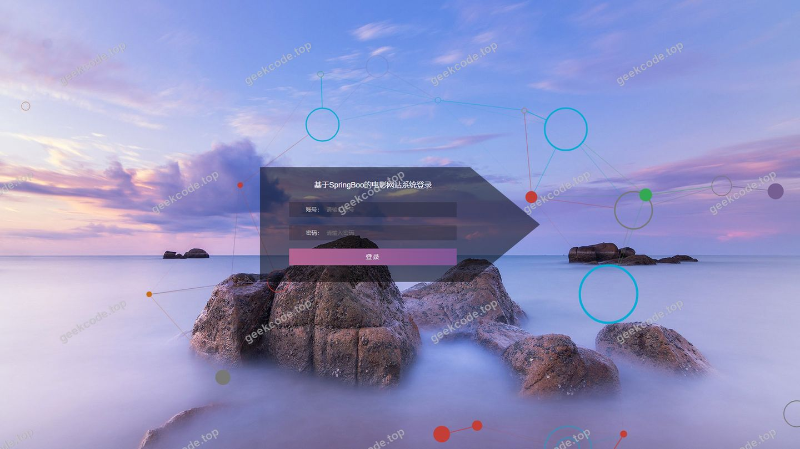
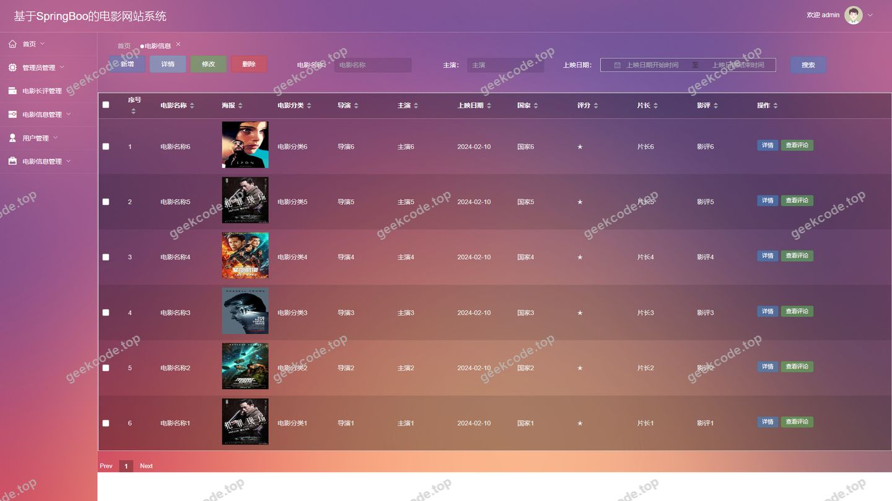
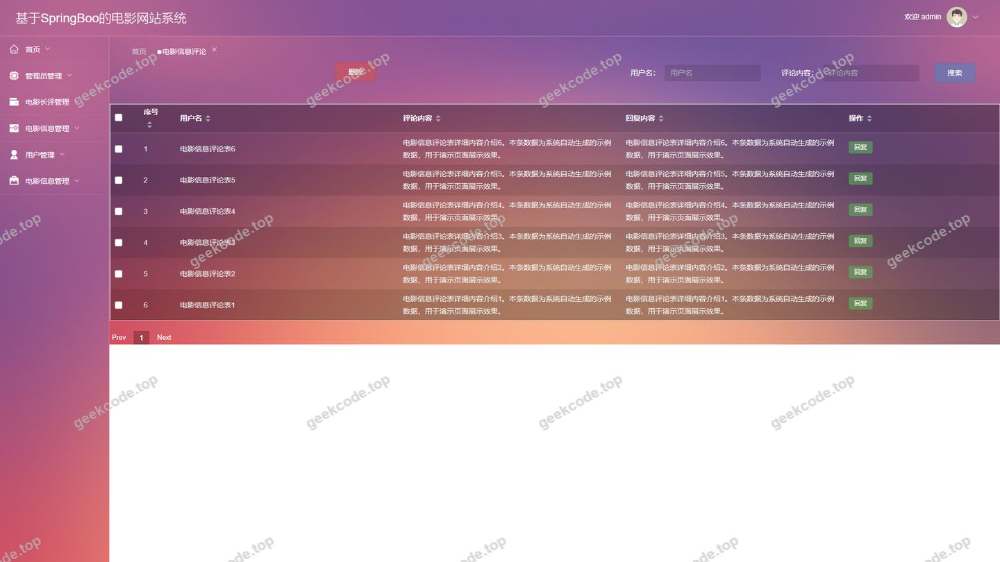
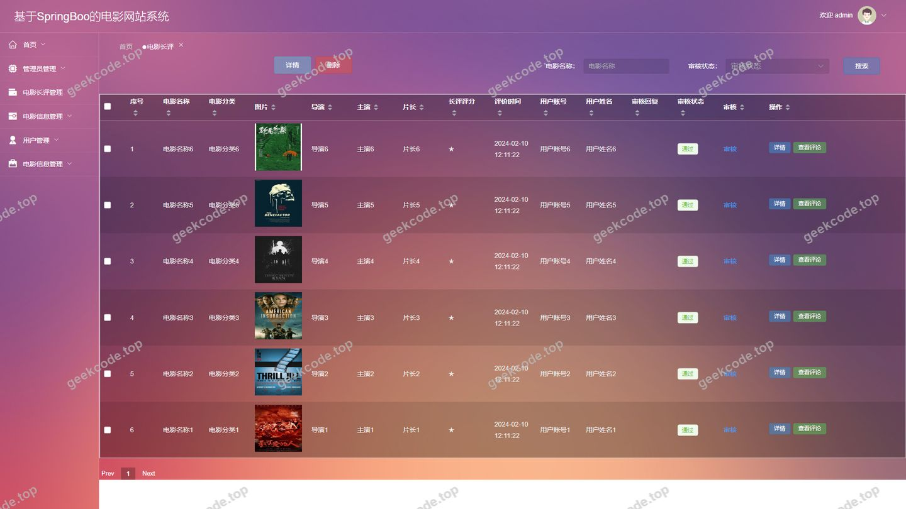
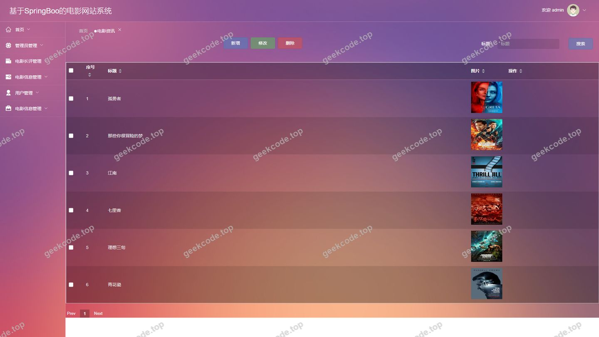
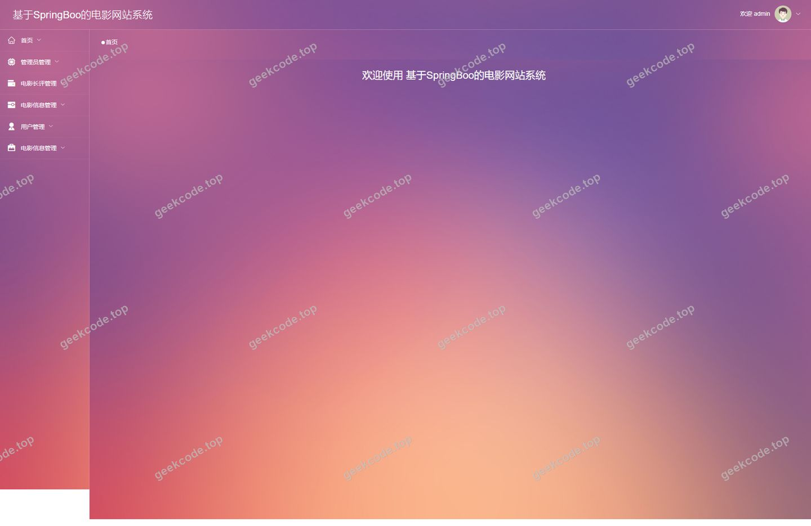
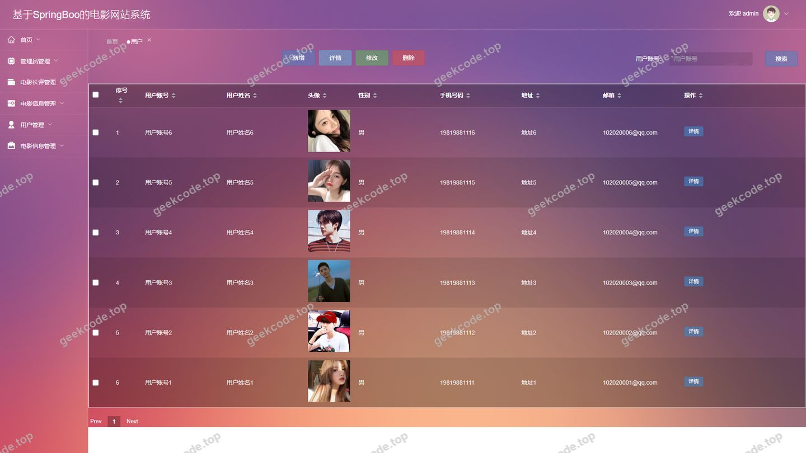

# 基于SpringBoo的电影网站系统

> 🎓 **计算机毕业设计 · 基于SpringBoo的电影网站系统**
>
> 本仓库只放**项目介绍 + 运行截图**（截图是站点带水印的原图，存在仓库 `images/` 里）。
>
> 👉 **完整可运行源码 / 数据库脚本 / 部署文档：[点我获取](https://geekcode.top/archives/%E5%9F%BA%E4%BA%8ESpringBoo%E7%9A%84%E7%94%B5%E5%BD%B1%E7%BD%91%E7%AB%99%E7%B3%BB%E7%BB%9F?utm_source=github)**
>
> 💬 咨询微信：**ir9372**　|　🌐 更多项目：[极客代码 geekcode.top](https://geekcode.top/?utm_source=github)
>
> 📌 项目详情页：<https://geekcode.top/archives/%E5%9F%BA%E4%BA%8ESpringBoo%E7%9A%84%E7%94%B5%E5%BD%B1%E7%BD%91%E7%AB%99%E7%B3%BB%E7%BB%9F?utm_source=github>

<table><td width="230" align="center"> <b>扫码加微信 ir9372</b></td><td valign="middle">📦 源码 = 项目介绍 + 全部运行截图 + 数据库 + 部署文档 👉 点上方任意截图，直接跳到 <b>极客代码 geekcode.top</b> 详情页</td></table>

---

<h1>基于SpringBoo的电影网站系统</h1>
<h2>项目概述</h2>

本项目旨在构建一个基于 Spring Boot 架构的电影资讯与评论管理平台，采用前后端分离的开发模式。系统核心功能涵盖电影分类管理、电影信息展示、长评发布与管理、用户互动评论以及后台数据维护。适用人群包括普通电影爱好者（前台用户）和网站运营管理人员（后台管理员）。技术架构上，后端选用 Spring Boot 结合 MyBatis-Plus 实现高效的数据持久化操作，引入 Shiro 框架进行安全认证与授权；前端通过 Vue.js 构建响应式界面。该项目解决了传统单体应用耦合度高、扩展性差的问题，提供了一个结构清晰、易于维护的电影垂直领域内容管理系统。

<h2>技术架构</h2>
<h3>1. 前后端分离架构</h3>

系统采用典型的前后端分离设计：

<ul>
<li><strong>后端服务</strong>：基于 Java 语言，使用 Spring Boot 框架作为核心容器，提供 RESTful API 接口。集成 MyBatis-Plus 简化数据库 CRUD 操作，利用 Apache Shiro 实现身份认证（Authentication）和授权（Authorization），确保接口访问的安全性。</li>
<li><strong>前端应用</strong>：基于 Vue.js 框架构建单页应用（SPA），通过 Axios 等 HTTP 客户端与后端接口交互，实现页面动态渲染和数据双向绑定。</li>
</ul>
<h3>2. 核心技术选型理由</h3>
<ul>
<li><strong>Spring Boot</strong>：具备“约定优于配置”的特性，快速搭建微服务或单体应用基础，内置 Tomcat 服务器，简化部署流程。</li>
<li><strong>MyBatis-Plus</strong>：在 MyBatis 基础上增强，提供通用 Mapper 和条件构造器，大幅减少样板代码，提升开发效率。</li>
<li><strong>Shiro</strong>：轻量级且强大的安全框架，适合中小型项目，能够灵活控制用户权限和会话管理。</li>
<li><strong>MySQL</strong>：关系型数据库，存储电影信息、用户数据及评论内容，保证数据的一致性和事务完整性。</li>
</ul>
<h3>3. 数据库设计要点</h3>

根据路由和功能模块推断，数据库主要包含以下实体表：

<ul>
<li><strong>用户表 (yonghu)</strong>：存储注册用户基本信息。</li>
<li><strong>电影分类表 (dianyingfenlei)</strong>：定义电影的类型标签。</li>
<li><strong>电影信息表 (dianyingxinxi)</strong>：存储电影详情、海报、简介等。</li>
<li><strong>电影长评表 (dianyingzhangping)</strong>：存储用户对电影的长篇深度评价。</li>
<li><strong>评论表 (discussdianyingxinxi / discussdianyingzhangping)</strong>：分别存储针对电影信息和长评的短评论。</li>
<li><strong>资讯表 (news)</strong>：存储电影相关的新闻动态。</li>
<li><strong>配置表 (config)</strong>：存储系统参数配置。</li>
</ul>
<h2>功能模块</h2>
<h3>1. 前台用户端</h3>

前台面向普通访客及注册用户，主要功能如下：

<ul>
<li><strong>首页与资讯浏览 (<code>/index/newsList</code>)</strong>：展示最新电影资讯列表，用户可点击查看新闻详情。</li>
<li><strong>电影分类管理 (<code>/index/dianyingfenlei*</code>)</strong>：<ul>
<li><code>List</code>: 浏览所有电影分类。</li>
<li><code>Detail</code>: 查看特定分类下的详细信息。</li>
<li><code>Add</code>: （注：通常由后台管理，此处路由存在可能为测试或特殊入口，依据常规逻辑主要为展示）</li>
</ul>
</li>
<li><strong>电影信息展示 (<code>/index/dianyingxinxi*</code>)</strong>：<ul>
<li><code>List</code>: 分页展示电影列表。</li>
<li><code>Detail</code>: 查看电影详情，包括简介、评分等。</li>
<li><code>Add</code>: （注：通常由后台录入，此处路由存在可能为测试或特殊入口）</li>
</ul>
</li>
<li><strong>电影长评社区 (<code>/index/dianyingzhangping*</code>)</strong>：<ul>
<li><code>List</code>: 浏览热门长评列表。</li>
<li><code>Detail</code>: 阅读具体长评内容及相关讨论。</li>
<li><code>Add</code>: 用户登录后发布新的电影长评。</li>
</ul>
</li>
<li><strong>用户中心 (<code>/index/yonghu*</code>)</strong>：<ul>
<li><code>Register</code>: 新用户注册账号。</li>
<li><code>List/Detail</code>: （注：前台通常不直接列出所有用户隐私，此路由可能用于特定场景如演员介绍或公开资料，但更常见的是个人中心）</li>
<li><code>Center</code>: 已登录用户的个人中心，查看和管理自己的收藏或发布的评论。</li>
</ul>
</li>
<li><strong>我的收藏 (<code>/index/storeupList</code>)</strong>：查看用户收藏的电影或文章列表。</li>
</ul>
<h3>2. 后台管理端</h3>

后台面向管理员，提供全面的数据管理和内容审核功能：

<ul>
<li><strong>系统登录</strong>：管理员通过账号密码进入后台首页。</li>
<li><strong>电影信息管理 (<code>/dianyingxinxi</code>)</strong>：增删改查电影的基本信息、封面图、上映时间等。</li>
<li><strong>电影分类管理 (<code>/dianyingfenlei</code>)</strong>：维护电影类型标签体系。</li>
<li><strong>电影长评管理 (<code>/dianyingzhangping</code>)</strong>：审核、编辑或删除用户提交的长篇影评。</li>
<li><strong>评论管理</strong>：<ul>
<li><code>/discussdianyingxinxi</code>: 管理针对电影信息的短评。</li>
<li><code>/discussdianyingzhangping</code>: 管理针对长评的回复评论。</li>
</ul>
</li>
<li><strong>用户管理 (<code>/yonghu</code>)</strong>：查看注册用户列表，禁用违规账号或重置密码。</li>
<li><strong>资讯管理 (<code>/news</code>)</strong>：发布和维护电影行业新闻、公告等内容。</li>
<li><strong>系统配置 (<code>/config</code>)</strong>：修改网站名称、Logo、轮播图等全局参数。</li>
</ul>
<h2>用户角色与权限</h2>

系统主要划分为两个角色：<strong>管理员</strong> 和 <strong>普通用户</strong>。

<table>
<thead>
<tr>
<th align="left">角色</th>
<th align="left">权限描述</th>
<th align="left">可访问功能模块</th>
</tr>
</thead>
<tbody><tr>
<td align="left"><strong>管理员</strong></td>
<td align="left">拥有系统的最高权限，负责内容审核、数据维护及系统配置。</td>
<td align="left"><strong>全部后台路由</strong>：- 电影信息管理- 电影分类管理- 电影长评管理- 电影信息评论管理- 电影长评评论管理- 用户管理- 资讯管理- 系统配置- 后台首页概览</td>
</tr>
<tr>
<td align="left"><strong>普通用户</strong></td>
<td align="left">需注册并登录，主要用于浏览内容、参与互动和社区贡献。</td>
<td align="left"><strong>部分前台路由</strong>：- <strong>未登录状态</strong>：浏览首页、资讯列表、电影列表、分类列表、长评列表、查看详情。- <strong>登录状态</strong>：在上述浏览权限基础上，增加：  - 发布电影长评 (<code>/index/dianyingzhangpingAdd</code>)  - 发表评论（针对电影或长评）  - 收藏内容 (<code>/index/storeupList</code>)  - 访问个人中心 (<code>/index/yonghuCenter</code>)</td>
</tr>
</tbody></table>

<em>注：根据现有源码路由分析，<code>/index/yonghuAdd</code> 和 <code>/index/dianyingxinxiAdd</code> 等添加类路由在前台存在，但在实际业务逻辑中，通常仅允许管理员在后台执行新增操作，或者限制为特定高级用户。若无明确代码注释表明前台开放新增权限，则默认遵循最小权限原则，即前台用户主要侧重于“读”和“评论/收藏”，而“写”核心数据（如电影元数据）由后台完成。</em>

<h2>项目特色与创新点</h2>
<ol>
<li><strong>垂直领域的内容聚合</strong>：不同于综合视频平台，本系统专注于“电影评论”这一细分领域，通过区分“短评论”和“长评”两种数据结构，满足了不同层次用户的表达需求，构建了更有深度的影迷社区。</li>
<li><strong>前后端分离的安全实践</strong>：采用 Shiro 框架进行细粒度的权限控制，有效防止了未授权访问和数据篡改，保障了用户隐私和后台数据安全。</li>
<li><strong>高效的开发体验</strong>：利用 MyBatis-Plus 的代码生成器和通用 Mapper，显著降低了 DAO 层的开发工作量，使得开发者能更聚焦于业务逻辑的实现。</li>
<li><strong>模块化设计</strong>：后台路由清晰地按照业务实体（电影、评论、用户、资讯）划分，便于后期维护和功能扩展，例如未来可增加“电影评分统计”或“推荐算法”模块。</li>
</ol>
<h2>部署环境</h2>

为确保系统正常运行，建议准备以下软件环境：

<table>
<thead>
<tr>
<th align="left">组件</th>
<th align="left">版本要求</th>
<th align="left">说明</th>
</tr>
</thead>
<tbody><tr>
<td align="left"><strong>JDK</strong></td>
<td align="left">Java 8 或 Java 11</td>
<td align="left">Spring Boot 运行所需的基础环境。</td>
</tr>
<tr>
<td align="left"><strong>Maven</strong></td>
<td align="left">3.6+</td>
<td align="left">用于项目依赖管理和打包构建。</td>
</tr>
<tr>
<td align="left"><strong>MySQL</strong></td>
<td align="left">5.7 或 8.0</td>
<td align="left">关系型数据库，需创建对应数据库实例并导入 SQL 脚本。</td>
</tr>
<tr>
<td align="left"><strong>Node.js</strong></td>
<td align="left">12.x - 16.x</td>
<td align="left">前端 Vue 项目编译和运行所需环境。</td>
</tr>
<tr>
<td align="left"><strong>IDE</strong></td>
<td align="left">IntelliJ IDEA / Eclipse</td>
<td align="left">后端代码开发与调试工具。</td>
</tr>
<tr>
<td align="left"><strong>浏览器</strong></td>
<td align="left">Chrome / Edge / Firefox</td>
<td align="left">现代浏览器，支持 ES6+ 语法以运行前端应用。</td>
</tr>
</tbody></table>

<strong>部署步骤简述</strong>：

<ol>
<li>安装 JDK 和 Maven，配置环境变量。</li>
<li>安装 MySQL，启动服务，创建数据库并执行初始化 SQL 文件。</li>
<li>克隆后端代码，修改 <code>application.yml</code> 中的数据库连接信息（URL, Username, Password）。</li>
<li>使用 Maven 命令 <code>mvn clean package</code> 打包后端 jar 包，并通过 <code>java -jar</code> 启动服务。</li>
<li>克隆前端代码，执行 <code>npm install</code> 安装依赖。</li>
<li>配置前端代理指向后端服务地址，执行 <code>npm run serve</code> 启动本地开发服务器，或 <code>npm run build</code> 生成静态文件部署至 Nginx/Apache。</li>
</ol>
<h2>五、技术特性</h2>
<ul>
<li>前后端分离架构，前端独立部署</li>
<li>使用 MyBatis-Plus 简化数据访问层开发</li>
<li>集成 Shiro 权限框架实现角色权限控制</li>
</ul>
<h2>六、功能模块截图</h2>
<h3>后台管理端</h3>
<h4>后台-登录页</h4>

<h4>后台-电影信息</h4>

<h4>后台-电影信息评论</h4>

<h4>后台-电影长评</h4>

<h4>后台-电影长评评论</h4>

<h4>后台-电影资讯</h4>

<h4>后台首页</h4>

<h4>后台-用户</h4>

---

## 获取完整源码

| 项目 | 说明 |
| --- | --- |
| 项目名 | 基于SpringBoo的电影网站系统 |
| 运行截图 | 本文 8 张（站点带水印原图，仓库 `images/` 目录） |
| 完整源码 | [https://geekcode.top/archives/%E5%9F%BA%E4%BA%8ESpringBoo%E7%9A%84%E7%94%B5%E5%BD%B1%E7%BD%91%E7%AB%99%E7%B3%BB%E7%BB%9F?utm_source=github](https://geekcode.top/archives/%E5%9F%BA%E4%BA%8ESpringBoo%E7%9A%84%E7%94%B5%E5%BD%B1%E7%BD%91%E7%AB%99%E7%B3%BB%E7%BB%9F?utm_source=github) |
| 咨询微信 | **ir9372**（备注：jingpin-yuanma） |
| 更多项目 | [极客代码 geekcode.top](https://geekcode.top/?utm_source=github) |

> 需要源码、部署、改配置、跑不起来等问题，加微信 ir9372 沟通，说明项目名即可。
